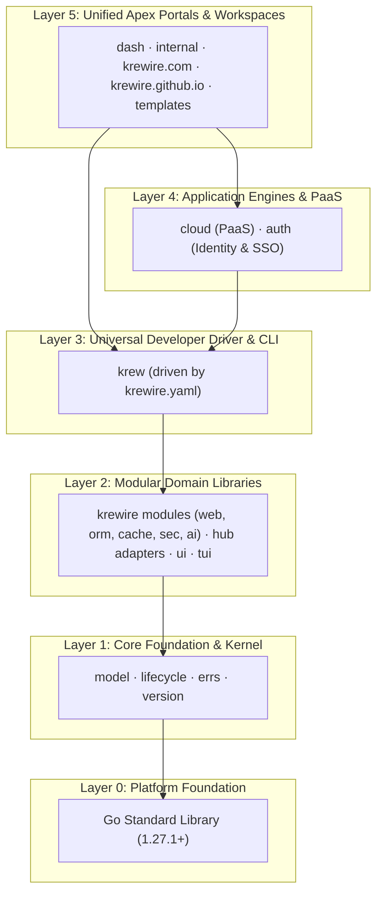

# Architecture — Krewire Ecosystem

System architecture, layering rules, module hierarchy, and design decisions across the Krewire monorepo and its constituent subsystems.

---

## 1. Ecosystem Overview

Krewire is an integrated, full-stack application and developer ecosystem built in Go (1.27.1+). It unifies eight distinct software workload kinds under a single declarative control plane, standard-library-aligned domain packages, a consolidated developer CLI, and an AI-native agent constitution.

The ecosystem spans eleven repositories:
1. **`krewire`** (Core Monorepo): 35 modular domain packages without root `go.mod`, 100% Go Standard Library, CGO-free, autonomous AI engine at `ai`, `apps/`, `templates/`.
2. **`hub`**: Public Port & Adapter repository for third-party integrations, external database drivers (`hub/sqlite`, `hub/postgres`, `hub/mysql`, `hub/redis`), and frontend compiler adapters (`hub/svelte`, `hub/tailwind`, `hub/vue`) (`github.com/krewire/hub`).
3. **`krew`**: Unified developer toolchain, CLI driver, and autonomous AI agent runtime (`github.com/krewire/krew`).
4. **`tui`**: Lightweight, pure-Go TUI framework and terminal primitives with zero external dependencies (`github.com/krewire/tui`).
5. **`ui`**: clean, modern `.kiw` design system, component catalog, and Model C package distribution (`github.com/krewire/ui`).
6. **`cloud`**: Private enterprise hybrid PaaS engine, runner supervisor, and multi-tenant control plane (`github.com/krewire/cloud`).
7. **`auth`**: Private enterprise identity, Single Sign-On (OIDC/SAML2), MFA (TOTP), and hierarchical RBAC platform (`github.com/krewire/auth`).
8. **`dash`**: Krewire Dash — AI-native virtual workspace, execution sandboxes, and collaboration presence (`github.com/krewire/dash`).
9. **`internal`**: Documentation hub: Architecture Decision Records (ADRs), roadmaps, and contributor guides (`github.com/krewire/internal`).
10. **`krewire.com`**: Public marketing and documentation website built with the `site` workload (`github.com/krewire/krewire.com`).
11. **`krewire.github.io`**: Community portal and open-source sponsorship portal (`github.com/krewire/krewire.github.io`).

---

## 2. Monorepo Structure

```text
krewire/
├── docs/                 # Ecosystem documentation (foundation, modules, tools, templates, guides)
│   ├── foundation/       # Unified architecture & philosophy specifications
│   ├── modules/          # Domain module technical references
│   ├── templates/        # Starter template and Boost documentation
│   └── guides/           # Operational and quality playbooks
├── ai/                   # Native AI SDK: providers, streaming, tools, schema, object generation
├── apicontract/          # Type-safe contract definitions and OpenAPI 3.1 schemas
├── app/                  # Dependency injection container & application assembly
├── assets/               # Asset management, pipeline, bundling, and hash busting
├── auth/                 # Authentication & token verification primitives (Basic Auth, JWT)
├── book/                 # Markdown content compiler (chapters, TOC, search)
├── cache/                # Multi-driver cache (memory, file)
├── cloud/                # Runner, service, worker, storage, infra, deploy targets
├── cmd/
│   └── ai/               # AI engine entrypoint and CLI driver
├── collab/               # Team roles and per-environment collaboration policies
├── commerce/             # Payment gateway integration (Midtrans)
├── config/               # Declarative configuration loader (krewire.yaml)
├── conformance/          # Architectural layering and conformance test suites
├── env/                  # Target environment resolution (local, production, testing)
├── errs/                 # POSIX-compatible exit codes, diagnostics, stack traces
├── file/                 # Atomic file operations and safe replacement
├── fs/                   # Testable filesystem abstraction boundary
├── functional/           # Generic collection and functional utilities (Map, Filter, Reduce)
├── i18n/                 # Internationalization, message bundles, pluralization, middleware
├── lifecycle/            # Workload execution dispatch, registry, executor, supervisor
├── log/                  # Structured slog logging tailored to environments
├── mail/                 # Multi-driver email delivery (SMTP, Resend, SendGrid, Postmark)
├── markdown/             # Markdown parsing & rendering with link prefixing
├── model/                # Declarative domain models, workload matrix, scopes, tiers, opt-in rules
├── observe/              # Cross-workload observability contract (W3C trace, metrics, probes)
├── orm/                  # Pure-Go multi-driver ORM & SQL query builder
├── resilience/           # Retry policies with exponential backoff & circuit breakers
├── router/               # High-performance HTTP request routing
├── runtime/              # WebAssembly client runtime (VDOM, mounting, widgets)
├── sec/                  # Secure defaults (headers, CSRF, CORS, SSRF, PII redaction)
├── storage/              # Persistent object storage abstractions (disk, memory, cloud)
├── templates/            # Starter templates and scaffolding blueprints
├── testing/              # Test harnesses and browser automation utilities
├── toolchain/            # AI-native toolchain contract & engine adapter protocol
├── validation/           # Schema and struct validation
├── version/              # Semantic versioning, compatibility checks, build watermark
├── web/                  # HTTP router, middleware, SSR, SSG, gateway, HMR
└── workgraph/            # Multi-module task execution DAG and affected-task runner
```

---

## 3. Layering Invariants & Dependency Rules

The Krewire architecture strictly enforces a **topological Directed Acyclic Graph (DAG)** where import dependencies may **only point strictly downward**. Lateral coupling between distinct domains is minimized, and upward imports are strictly prohibited.

---

### 3.1. Architectural Layer Hierarchy



---

### 3.2. Layer Definitions & Allowable Edges

| Layer | Layer Name | Module Scope | Allowed Imports | Strictly Prohibited Imports |
|---|---|---|---|---|
| **Layer 5** | Scaffolding & Agentic Blueprints | `templates/boost`, `templates/init`, `templates/new` | Layers 0, 1, 2, 3, 4 | External project application code |
| **Layer 4** | Developer Tooling | `krew` | Layers 0, 1, 2, 3 | Layer 5, Consumer application binaries |
| **Layer 3** | Universal Developer Driver | `krew` | Layers 0, 1, 2 | Layers 4, 5 |
| **Layer 2** | Execution & Supervision | `lifecycle`, `env`, `log` | Layers 0, 1, and `env` for `log` | Layers 3, 4, 5 (Zero domain package imports) |
| **Layer 1** | Declarative Core & Base Primitives | `errs`, `model`, `version` | Layer 0 (stdlib only; `model` and `version` may import `errs`) | Layers 2, 3, 4, 5, Third-party packages |
| **Layer 0** | Platform Runtime | Go Standard Library | None (Compiler runtime) | Any non-stdlib package |

---

### 3.3. The Six Core Layering Invariants

The monorepo enforces six non-negotiable architectural invariants via automated test guards:

#### Invariant 1: Downward-Only Directionality
- **Rule:** For any package import edge $A \rightarrow B$, the architectural layer of $A$ must be strictly greater than $B$ ($Layer(A) > Layer(B)$), or within Layer 3 where $A$ and $B$ form a strictly acyclic dependency.
- **Rationale:** Prevents circular dependencies, simplifies mental models, and ensures leaf packages can be compiled, benchmarked, and audited in total isolation.
- **Enforcement:** Verified via AST analysis in [`layering_test.go`](../../conformance/layering_test.go): `TestFoundationLayering` checks every foundation import edge against the ranked ladder, and `TestUIDoesNotImportWeb` pins the one sibling direction the architecture states explicitly.

#### Invariant 2: Base Floor Invariant
- **Rule:** `errs` is the floor of the ecosystem dependency graph: it imports the standard library only. `model` and `version` sit directly above it and may import `errs` and nothing else from the ecosystem. No base package may import a domain package.
- **Rationale:** If base packages depended on a domain package (such as `web` or `config`), every package in the ecosystem would transitively drag those dependencies along, destroying modularity.
- **Enforcement:** [`errs/dependency_test.go`](../../modules/errs/dependency_test.go) (`TestImportBoundary`) and [`model/dependency_test.go`](../../modules/model/dependency_test.go) (`TestModel_StdlibBoundary`) assert the per-package boundaries; [`layering_test.go`](../../conformance/layering_test.go) (`TestFoundationLayering`) keeps the rest of the foundation ladder ranked and acyclic.

#### Invariant 3: Zero-Ecosystem Coupling in Base Foundation
- **Rule:** Base foundation packages must contain **zero** references, string literals, or constants naming higher-layer modules or packages (`github.com/krewire/*`).
- **Rationale:** True scalability requires that adding a new domain module never requires a corresponding code edit in a foundation package. The guard walks the foundation packages and flags any string literal that names a package ranked at or above it, so a new domain package can be added without touching them.
- **Enforcement:** Verified via AST literal inspection in [`layering_test.go`](../../conformance/layering_test.go) (`TestFoundationNamesNoHigherPackage`).

#### Invariant 4: Hermetic Core Boundary
- **Rule:** `model` may import **only** the Go standard library and its internal `errs` sibling. It must never import external third-party dependencies or other Krewire packages.
- **Rationale:** Ensures that business models, workload definitions, and scope hierarchies are 100% portable, pure, and immune to third-party vulnerability churn.
- **Enforcement:** Verified in [`model/dependency_test.go`](../../modules/model/dependency_test.go) (`TestModel_StdlibBoundary`) and [`errs/dependency_test.go`](../../modules/errs/dependency_test.go) (`TestImportBoundary`).

#### Invariant 5: Complete Tooling Isolation (No `krew` Imports)
- **Rule:** No foundational domain module or template may ever import `krew` or `github.com/krewire/kiw`.
- **Rationale:** Developer tooling consumes domain libraries; libraries never consume developer tooling. Logic needed by both must reside in a domain package (e.g. `hub/resolver`, `tui`), never inside CLI commands.
- **Enforcement:** Verified via AST analysis in [`layering_test.go`](../../conformance/layering_test.go) (`TestPackagesNeverImportKiw`).

---

## 4. Domain Model & Workload Spectrum

### The Workload Spectrum
The Krewire ecosystem progressively handles 8 canonical software capabilities without rigid silos or artificial kind boundaries:
- **Web Applications**: Full-stack dynamic web applications (HTTP router, DI container, SSR, client WASM).
- **CLI Tools**: Standalone terminal commands and developer utilities.
- **Static Sites**: Content and marketing sites with static site generation (SSG) and HMR.
- **Documentation Books**: Structured multi-chapter technical documentation books (powered by native `book`).
- **Workers**: Background processing queues, event consumers, and scheduled jobs.
- **Backend Services**: Headless backend microservices and RPC/REST APIs.
- **Gateways**: API gateways that proxy requests along a declarative route table and discover upstreams.
- **Infrastructure**: Declarative cloud infrastructure blueprints and state management.

### Scope Hierarchy as Code (`model.Scope`)
System boundaries are codified through five explicit scope levels:
```text
Workspace  ───►  Module  ───►  Domain  ───►  Service  ───►  Unit
```
- **Workspace:** Multi-module Go workspace rooted at `go.work`.
- **Module:** Deployable or distributable Go module (e.g. `github.com/krewire/krewire`).
- **Domain:** Functional subsystem or package group (e.g. `web`, `cloud`, `ui`).
- **Service:** Deployable service or autonomous process.
- **Unit:** Individual Go package, file, or component adhering to Single Responsibility Principle (SRP).

Scope levels structure architecture and testing across the workspace.

### Single Configuration Authority (`krewire.yaml`)
- `krewire.yaml` is the sole declarative configuration authority for the project. Obsolete formats (e.g., `ssg.yaml`) are strictly disallowed.
- Project name must follow kebab-case `^[a-z][a-z0-9-]*$`.
- Module path is validated against directory traversal risks (`CWE-22`).

---

## 5. Subsystem Architecture

### A. Core Control Plane & Base Primitives (`model`, `lifecycle`, `errs`)
- **Lifecycle & Module Registry (`lifecycle`):** Provides structured lifecycle phases (`Init`, `Start`, `Stop`) with supervisor capabilities, graceful shutdown, and context propagation.
- **Error Handling & Exit Codes (`errs`):** Structured error categorization (`UsageError`, `FailureError`), stack trace capture, and deterministic process exit codes (`0`, `1`, `2`).
- **Environment & Logging (`env`, `log`):** Standard-library-based structured logging (`log/slog`) with environment-aware formatting (JSON in production, styled text in local development) and automatic PII redaction.
- **Declarative Models & Boundaries (`model`):** Scope hierarchy, licensing tiers, and project validation constraints.
- **Versioning & Watermark (`version`):** Semantic version contracts, compatibility validation, and build signature watermarking.

### B. Domain Modules (35 Modules in `krewire`)
- **Web (`web`):** High-throughput HTTP routing, pipeline middleware, SSR templating, SSG asset pipeline, WebSocket-driven HMR, and API gateway routing.
- **Runtime (`runtime`):** WebAssembly client engine compiled with `GOOS=js`, providing a lightweight Virtual DOM (VDOM), declarative component mounting, and reactive widget islands.
- **Security (`sec`):** Secure defaults out-of-the-box: OWASP-compliant security headers, CSRF token generation/validation, CORS configuration, URL SSRF defense, and structured log sanitization.
- **Storage & Cloud (`storage`, `cloud`):** Pluggable object storage abstractions (local filesystem and cloud object stores) with deployment runners, service discovery, and worker queues.
- **Config & Validation (`config`, `validation`):** Type-safe YAML unmarshaling with struct tag validation (`validate:"required"`).

### C. Developer Tooling — `krew` (`krew`)
- **Unified Entry Point:** A single binary (`krew`) replacing fragmented shell scripts or separate CLI binaries.
- **Pipeline Dispatch:** `krew` inspects project markers and `krewire.yaml` to detect project kind (`shape`) and route commands:
  - `build` / `serve`: Dispatches SSG pipeline for `site`, book pipeline for `book`, or Go binary builds for `app`/`cli`.
  - `run` / `dev`: Executes local apps, standalone scripts, or defined tasks with hot-reload.
  - `deploy`: Prepares and stages production artifacts into `.krewire/dist/`.
  - `new` / `init`: Scaffolds projects from bootstrap blueprints and equips them with workload variants.
- **Dogfooding:** Built entirely on `tui` for interactive terminal UI, `errs` for status and error codes, and `version` for versioning.

### D. AI-Native Boost Engine (`boost` & `templates/boost`)
- **Embedded Agent Constitution:** Embedded via `//go:embed` into `boost`, providing a pre-configured multi-agent orchestration team (`.agents/`).
- **21 Specialized Agents & Workflows:** Covers planning, architecture, implementation, refactoring, security auditing, and continuous learning.
- **Project Governance:** Standardized rules and templates installed via `krew boost install` into any new or existing repository.

---

## 6. Progress Tracking & Quality Gates

### GitHub Issues as SSOT
Active tasks, features, and fixes are maintained as GitHub Issues under `krewire/krewire`. Every issue contains verifiable checklists (`- [ ]` / `- [x]`).

### Required Quality Gates
Every contribution must cleanly pass the monorepo quality gates:
```bash
gofmt -l .        # Must output nothing
go vet ./...      # Must pass without lint warnings
go test ./...     # All unit and integration tests must pass
go build -o bin/krew ./github.com/krewire/krew/cmd/krew # CLI binary must build cleanly
```
