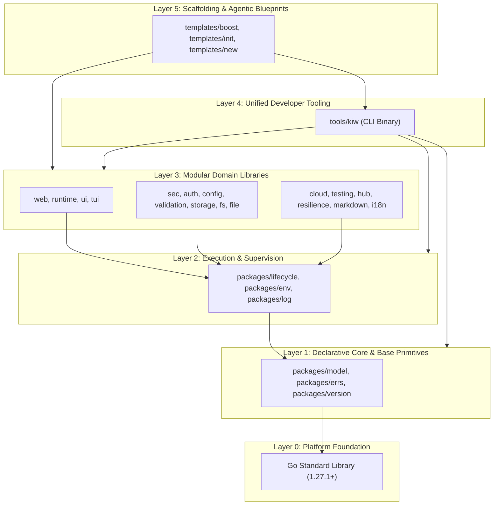

# Architecture — Krewire Ecosystem

System architecture, layering rules, module hierarchy, and design decisions across the Krewire monorepo and its constituent subsystems.

---

## 1. Ecosystem Overview

Krewire is an integrated, full-stack application and developer ecosystem built in Go (1.27.1+). It unifies eight distinct software workload kinds under a single declarative control plane, standard-library-aligned domain packages, a consolidated developer CLI, and an AI-native agent constitution.

The ecosystem spans five repositories:
1. **`krewire`** (Core Monorepo): Domain packages, kernel executor, developer CLI (`kiw`), first-party apps, and templates.
2. **`mdbind`**: Standalone Markdown book & documentation engine powering the `book` workload.
3. **`internal`**: Private documentation, ADRs, roadmaps, and project vision.
4. **`krewire.com`**: Public marketing and documentation website built with the `site` workload.
5. **`krewire.github.io`**: Community portal and distribution hub.

---

## 2. Monorepo Structure

```text
krewire/
├── docs/                 # Ecosystem documentation (Foundation, Packages, Boost, Devtool)
│   ├── foundation/       # Unified Architecture & Philosophy specifications
│   ├── packages/         # Domain packages and module specifications
│   └── tools/kiw/        # Developer CLI documentation
├── packages/             # Domain libraries and control plane (25 modular packages)
│   ├── kern/             # Bedrock control plane: model, lifecycle, errs, log, env, version
│   ├── web/              # HTTP router, middleware, SSR, SSG, gateway, HMR
│   ├── app/              # Dependency injection container & application assembly
│   ├── ui/               # UI components, layout, styling tokens, CSS theme palettes
│   ├── tui/              # Terminal UI toolkit powering the kiw CLI
│   ├── runtime/          # WebAssembly client runtime (VDOM, mounting, widgets)
│   ├── ai/               # Native AI SDK: providers, streaming, tools, schema, object generation
│   ├── sec/              # Secure defaults (headers, CSRF, CORS, SSRF, PII redaction)
│   ├── auth/             # Authentication & token verification primitives (Basic Auth, JWT)
│   ├── assets/           # Asset management, pipeline, bundling, and hash busting
│   ├── cloud/            # Runner, service, worker, storage, infra, deploy targets
│   ├── config/           # Declarative configuration loader (krewire.yaml)
│   ├── file/             # Atomic file operations and safe replacement
│   ├── fs/               # Testable filesystem abstraction boundary
│   ├── functional/       # Generic collection and functional utilities (Map, Filter, Reduce)
│   ├── hub/              # Plugin registry and package resolver
│   ├── i18n/             # Internationalization, message bundles, pluralization, middleware
│   ├── kiw/              # .kiw DSL compiler, parser, AST desugaring, component engine
│   ├── markdown/         # Markdown parsing & rendering with link prefixing
│   ├── resilience/       # Retry policies with exponential backoff & circuit breakers
│   ├── storage/          # Persistent object storage abstractions (disk, memory, cloud)
│   ├── term/             # Terminal detection, ANSI colors, and output formatting
│   ├── testing/          # Test harnesses and browser automation utilities
│   ├── validation/       # Schema and struct validation
│   └── boost/            # Boost coordination package & embedded agentic template
├── apps/                 # Deployable services and applications
├── tools/                # Developer tooling
│   └── kiw/              # Unified developer CLI for scaffolding, build, and deploy
└── templates/            # Starter templates and scaffolding blueprints
    ├── boost/            # AI-agent workflow template and constitution (.agents/)
    ├── init/             # In-place project initialization templates (app, book, cli, static)
    └── new/              # Fresh project scaffolding blueprints (kernel)
```

---

## 3. Layering Invariants & Dependency Rules

The Krewire architecture strictly enforces a **topological Directed Acyclic Graph (DAG)** where import dependencies may **only point strictly downward**. Lateral coupling between distinct domains is minimized, and upward imports are strictly prohibited.

---

### 3.1. Architectural Layer Hierarchy



---

### 3.2. Layer Definitions & Allowable Edges

| Layer | Layer Name | Module Scope | Allowed Imports | Strictly Prohibited Imports |
|---|---|---|---|---|
| **Layer 5** | Scaffolding & Agentic Blueprints | `templates/boost`, `templates/init`, `templates/new` | Layers 0, 1, 2, 3, 4 | External project application code |
| **Layer 4** | Developer Tooling | `tools/kiw` | Layers 0, 1, 2, 3 | Layer 5, Consumer application binaries |
| **Layer 3** | Domain Libraries | `packages/*` (`web`, `sec`, `cloud`, `storage`, `ui`, etc.) | Layers 0, 1, 2, Sibling Layer 3 (strictly acyclic) | Layers 4, 5 (`tools/kiw` or `templates/*`) |
| **Layer 2** | Execution & Supervision | `packages/lifecycle`, `packages/env`, `packages/log` | Layers 0, 1 | Layers 3, 4, 5 (Zero domain package imports) |
| **Layer 1** | Declarative Core & Base Primitives | `packages/model`, `packages/errs`, `packages/version` | Layer 0 (Stdlib only; `model` may import `errs`) | Layers 2, 3, 4, 5, Third-party packages |
| **Layer 0** | Platform Runtime | Go Standard Library | None (Compiler runtime) | Any non-stdlib package |

---

### 3.3. The Six Core Layering Invariants

The monorepo enforces six non-negotiable architectural invariants via automated test guards:

#### Invariant 1: Downward-Only Directionality
- **Rule:** For any package import edge $A \rightarrow B$, the architectural layer of $A$ must be strictly greater than $B$ ($Layer(A) > Layer(B)$), or within Layer 3 where $A$ and $B$ form a strictly acyclic dependency.
- **Rationale:** Prevents circular dependencies, simplifies mental models, and ensures leaf packages can be compiled, benchmarked, and audited in total isolation.
- **Enforcement:** Verified via AST analysis in [`layering_test.go`](../../layering_test.go) (`TestDownwardImportsOnly`).

#### Invariant 2: Base Floor Invariant
- **Rule:** Base foundation packages (`packages/errs`, `packages/model`, `packages/version`) sit at the floor of the ecosystem dependency graph ($Depth(\text{base}) = 0$ above stdlib). They require no other ecosystem module.
- **Rationale:** If base packages depended on a domain package (such as `web` or `config`), every package in the ecosystem would transitively drag those dependencies along, destroying modularity.
- **Enforcement:** Verified in [`layering_test.go`](../../layering_test.go).

#### Invariant 3: Zero-Ecosystem Coupling in Base Foundation
- **Rule:** Base foundation packages must contain **zero** references, string literals, or constants naming higher-layer modules or packages (`github.com/krewire/*`).
- **Rationale:** True scalability requires that adding a new package to `packages/` never requires a corresponding code edit in base packages. The ecosystem roster is derived dynamically at runtime from `go.work` and module descriptors.
- **Enforcement:** Verified via AST literal inspection in [`layering_test.go`](../../layering_test.go) (`TestNoEcosystemNames`).

#### Invariant 4: Hermetic Core Boundary
- **Rule:** `packages/model` may import **only** the Go standard library and its internal `errs` sibling. It must never import external third-party dependencies or other Krewire packages.
- **Rationale:** Ensures that business models, workload definitions, and scope hierarchies are 100% portable, pure, and immune to third-party vulnerability churn.
- **Enforcement:** Verified in [`packages/model/dependency_test.go`](../../packages/model/dependency_test.go) (`TestModel_StdlibBoundary`) and [`packages/errs/dependency_test.go`](../../packages/errs/dependency_test.go) (`TestImportBoundary`).

#### Invariant 5: Complete Tooling Isolation (No `kiw` Imports)
- **Rule:** No package under `packages/` or `templates/` may ever import `tools/kiw` or `github.com/krewire/kiw`.
- **Rationale:** Developer tooling consumes domain libraries; libraries never consume developer tooling. Logic needed by both must reside in a domain package (e.g. `packages/hub/resolver`, `packages/tui`), never inside CLI commands.
- **Enforcement:** Enforced at compile time and validated during package build pipelines.

#### Invariant 6: Opt-In Battery Boundaries (`OptInRule`)
- **Rule:** Packages classified as specialized batteries for a specific workload kind (e.g. `cloud/worker`, `web/ssg`) are blocked from uninvited cross-import by non-owning kinds unless explicitly opted in.
- **Rationale:** Guarantees that lightweight workloads (such as `cli` or `kernel`) incur zero binary weight or initialization cost from features they do not use.
- **Enforcement:** Enforced via declarative opt-in policies in [`packages/model/project.go`](../../packages/model/project.go#L82) (`ViolatesOptIn`).

---

## 4. Domain Model & Workload Spectrum

### The Eight Workload Kinds (`model.Kind`)
Every project in the ecosystem belongs to one of eight canonical kinds:
- **`app`**: Full-stack dynamic web applications (HTTP router, DI container, SSR, client WASM).
- **`cli`**: Standalone terminal commands and developer utilities.
- **`site`**: Content and marketing sites with static site generation (SSG) and HMR.
- **`book`**: Structured multi-chapter technical documentation books (integrated with `mdbind`).
- **`worker`**: Background processing queues, event consumers, and scheduled jobs.
- **`service`**: Headless backend microservices and RPC/REST APIs.
- **`infra`**: Declarative cloud infrastructure blueprints and state management.
- **`kernel`**: Minimal initial seed project (`go.mod` + `krewire.yaml` + `main.go`).

### Scope Hierarchy as Code (`model.Scope`)
System boundaries are codified through five explicit scope levels:
```text
Workspace  ───►  Module  ───►  Domain  ───►  Service  ───►  Unit
```
- **Workspace:** Multi-module Go workspace rooted at `go.work`.
- **Module:** Deployable or distributable Go module (e.g. `github.com/krewire/krewire`).
- **Domain:** Functional subsystem or package group (e.g. `web`, `cloud`, `ui`).
- **Service:** Deployable service or autonomous process.
- **Unit:** Individual Go package, file, or component adhering to Single Responsibility Principle (SRP).

Scope levels structure architecture and testing across the workspace.

### Single Configuration Authority (`krewire.yaml`)
- `krewire.yaml` is the sole declarative configuration authority for every workload. Obsolete formats (e.g., `ssg.yaml`) are strictly disallowed.
- Project name must follow kebab-case `^[a-z][a-z0-9-]*$`.
- Module path is validated against directory traversal risks (`CWE-22`).

### Opt-In Batteries (`OptInRule`)
Batteries are opt-in per workload kind. A project of kind `For` cannot import packages owned by kind `Owner` unless explicitly opted in. This guarantees zero bloat and zero-cost abstraction for lightweight kinds (such as `cli` or `kernel`).

---

## 5. Subsystem Architecture

### A. Core Control Plane & Base Primitives (`packages/model`, `packages/lifecycle`, `packages/errs`)
- **Lifecycle & Module Registry (`packages/lifecycle`):** Provides structured lifecycle phases (`Init`, `Start`, `Stop`) with supervisor capabilities, graceful shutdown, and context propagation.
- **Error Handling & Exit Codes (`packages/errs`):** Structured error categorization (`UsageError`, `FailureError`), stack trace capture, and deterministic process exit codes (`0`, `1`, `2`).
- **Environment & Logging (`packages/env`, `packages/log`):** Standard-library-based structured logging (`log/slog`) with environment-aware formatting (JSON in production, styled text in local development) and automatic PII redaction.
- **Declarative Models & Workload Matrix (`packages/model`):** Canonical workload kinds, scope hierarchy, licensing tiers, and opt-in import constraints.
- **Versioning & Watermark (`packages/version`):** Semantic version contracts, compatibility validation, and build signature watermarking.

### B. Domain Libraries (`packages/*`)
- **Web (`packages/web`):** High-throughput HTTP routing, pipeline middleware, SSR templating, SSG asset pipeline, WebSocket-driven HMR, and API gateway routing.
- **Runtime (`packages/runtime`):** WebAssembly client engine compiled with `GOOS=js`, providing a lightweight Virtual DOM (VDOM), declarative component mounting, and reactive widget islands.
- **Security (`packages/sec`):** Secure defaults out-of-the-box: OWASP-compliant security headers, CSRF token generation/validation, CORS configuration, URL SSRF defense, and structured log sanitization.
- **Storage & Cloud (`packages/storage`, `packages/cloud`):** Pluggable object storage abstractions (local filesystem and cloud object stores) with deployment runners, service discovery, and worker queues.
- **Config & Validation (`packages/config`, `packages/validation`):** Type-safe YAML unmarshaling with struct tag validation (`validate:"required"`).

### C. Developer Tooling — `kiw` (`tools/kiw`)
- **Unified Entry Point:** A single binary (`kiw`) replacing fragmented shell scripts or separate CLI binaries.
- **Pipeline Dispatch:** `kiw` inspects project markers and `krewire.yaml` to detect project kind (`shape`) and route commands:
  - `build` / `serve`: Dispatches SSG pipeline for `site`, `mdbind` pipeline for `book`, or Go binary builds for `app`/`cli`.
  - `run` / `dev`: Executes local apps, standalone scripts, or defined tasks with hot-reload.
  - `deploy`: Prepares and stages production artifacts into `dist/`.
  - `new` / `init`: Scaffolds projects from kernel blueprints and equips them with workload variants.
- **Dogfooding:** Built entirely on `packages/tui` for interactive terminal UI, `packages/errs` for status and error codes, and `packages/version` for versioning.

### D. AI-Native Boost Engine (`packages/boost` & `templates/boost`)
- **Embedded Agent Constitution:** Embedded via `//go:embed` into `packages/boost`, providing a pre-configured multi-agent orchestration team (`.agents/`).
- **20 Specialized Agents & Workflows:** Covers planning, architecture, implementation, refactoring, security auditing, and continuous learning.
- **Project Governance:** Standardized rules and templates installed via `kiw boost install` into any new or existing repository.

---

## 6. Progress Tracking & Quality Gates

### GitHub Issues as SSOT
Active tasks, features, and fixes are maintained as GitHub Issues under `krewire/krewire`. Every issue contains verifiable checklists (`- [ ]` / `- [x]`).

### Required Quality Gates
Every contribution must cleanly pass the monorepo quality gates:
```bash
gofmt -l .        # Must output nothing
go vet ./...      # Must pass without lint warnings
go test ./...     # All unit and integration tests must pass
go build -o bin/kiw ./tools/kiw/cmd/kiw # CLI binary must build cleanly
```
